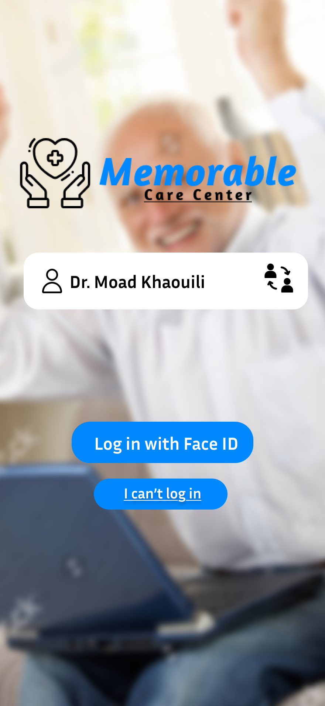
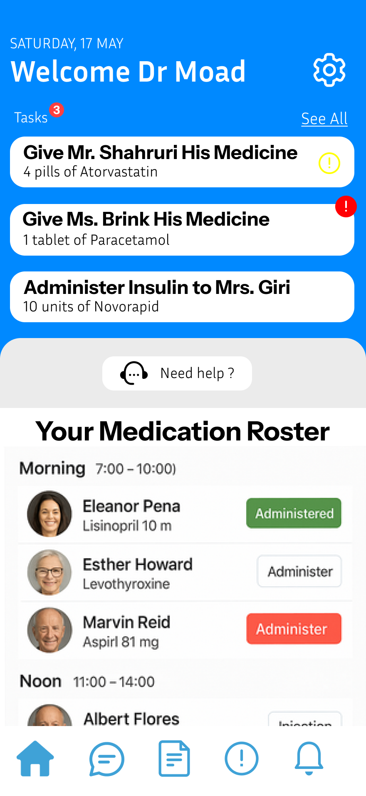
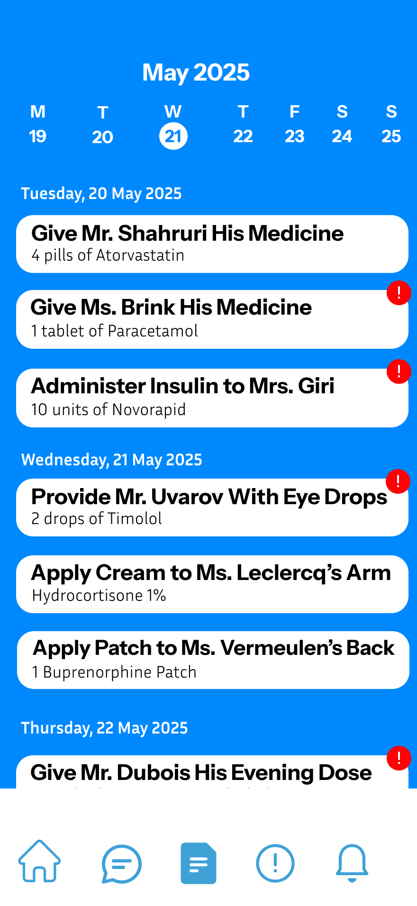
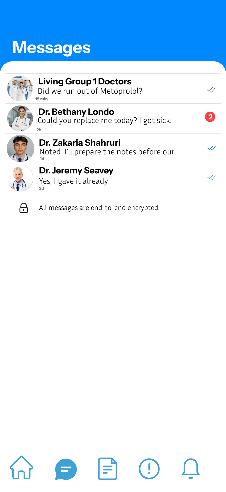

<a id="readme-top"></a>

<br />
<div align="center">
  

  <h3 align="center">Memorable</h3>

  <p align="center">
    A care app for staff in elderly care clinics: medication rounds, tasks and team communication in one place — replacing paper lists.
    <br />
    <br />
    <a href="https://memorable-nu.vercel.app/"><strong>Open the live PWA »</strong></a>
    <br />
    <br />
    <a href="#demo-login">Demo login</a>
    ·
    <a href="#the-idea">The idea</a>
    ·
    <a href="#getting-started">Run it locally</a>
  </p>
</div>

<details>
  <summary>Table of Contents</summary>
  <ol>
    <li><a href="#about-the-project">About The Project</a>
      <ul>
        <li><a href="#features">Features</a></li>
        <li><a href="#built-with">Built With</a></li>
      </ul>
    </li>
    <li><a href="#demo-login">Demo Login</a></li>
    <li><a href="#getting-started">Getting Started</a>
      <ul>
        <li><a href="#prerequisites">Prerequisites</a></li>
        <li><a href="#installation">Installation</a></li>
        <li><a href="#database-setup-supabase">Database setup (Supabase)</a></li>
      </ul>
    </li>
    <li><a href="#usage">Usage</a></li>
    <li><a href="#project-structure">Project Structure</a></li>
    <li><a href="#the-idea">The Idea</a>
      <ul>
        <li><a href="#target-audience">Target audience</a></li>
        <li><a href="#what-we-are-building">What we are building</a></li>
        <li><a href="#roadmap">Roadmap</a></li>
        <li><a href="#competitors">Competitors</a></li>
      </ul>
    </li>
    <li><a href="#known-limitations">Known Limitations</a></li>
    <li><a href="#contact">Contact</a></li>
    <li><a href="#acknowledgments">Acknowledgments</a></li>
  </ol>
</details>

## About The Project

<p align="center">
  
  
  
  
</p>
<p align="center"><em>Figma designs of the login, home, tasks and messages screens.</em></p>

In many care homes for elderly people, staff still keep track of medication and daily care on paper. Paper lists get lost, are hard to read, and nobody gets a reminder when a dose is due — which leads to mistakes and missed tasks.

**Memorable** gives clinic staff one simple app on their phone:

* Log in with your own staff account and see **today's tasks** and your **medication roster**
* Mark a medication as **administered** with one tap
* See the **patients** of the clinic and open their file
* **Message** colleagues and get **notifications** for medication that is due or running low
* Ask **Memo**, the help assistant, quick questions about the app and daily care

This repository is the **PWA (Progressive Web App)** version, the first assignment of the Mobile Applications course at UCLL. It is built on the course starter codebase and will be turned into a native iOS/Android app in the second assignment.

<p align="right">(<a href="#readme-top">back to top</a>)</p>

### Features

| Screen | What it does |
|---|---|
| **Login** | Pick your name from the staff list and enter your password. Switch to another staff member at any time. |
| **New staff member** | Create a staff account (title, name, role, email, password). |
| **Home** | Today's date and tasks, a help button and the medication roster per time slot (morning / noon / evening). |
| **Tasks** | Week overview; tasks grouped per day, tap a day to filter. |
| **Messages** | Conversations with colleagues; open a chat and send messages. |
| **Patients** | List of residents from the database with search, and a patient file (room, age, care notes). |
| **Notifications** | Medication due, stock running low, new messages, announcements. |
| **Help** | Ask Memo (the assistant), common questions, on-call doctor and IT helpdesk. |
| **Settings** | Search through settings, switch staff member, log out. |

The app is installable (manifest + service worker), works in a phone-width layout on desktop and keeps the last loaded pages available offline.

<p align="right">(<a href="#readme-top">back to top</a>)</p>

### Built With

* [Expo](https://expo.dev/) (SDK 52) with [Expo Router](https://docs.expo.dev/router/introduction/)
* [React Native](https://reactnative.dev/) + [React Native Web](https://necolas.github.io/react-native-web/)
* [TypeScript](https://www.typescriptlang.org/) (strict)
* [Zustand](https://zustand-demo.pmnd.rs/) for state management
* [Supabase](https://supabase.com/) for the database and authentication
* [Cypress](https://www.cypress.io/) for end-to-end tests, [Storybook](https://storybook.js.org/) for the base components
* Hosted on [Vercel](https://vercel.com/)

<p align="right">(<a href="#readme-top">back to top</a>)</p>

## Demo Login

Open the [live PWA](https://memorable-nu.vercel.app/), tap a name in the staff list on the login screen and enter the password:

| | |
|---|---|
| **Staff member** | Any staff member in the list, e.g. **Dr. Niels Jacobs** |
| **Password** | `aaaaaaaa` (the same for every demo staff account) |

No email address is needed: you choose the staff member from the list. You can also create your own account with **Add new staff member** at the bottom of the staff list. All staff accounts are fictional demo accounts.

<p align="right">(<a href="#readme-top">back to top</a>)</p>

## Getting Started

### Prerequisites

* [Node.js](https://nodejs.org/) 18 or newer
* A free [Supabase](https://supabase.com/) project

### Installation

1. Clone the repository
   ```sh
   git clone https://github.com/Moad-KHAOUILI/memorable.git
   cd memorable
   ```
2. Install the packages
   ```sh
   npm install
   ```
3. Create a `.env` file in the project root with your Supabase project URL and anon (publishable) key
   ```sh
   EXPO_PUBLIC_SUPABASE_URL=https://your-project.supabase.co
   EXPO_PUBLIC_SUPABASE_ANON_KEY=your-anon-key
   ```
4. Start the app in the browser
   ```sh
   npm run web
   ```
   On the UCLL network (eduroam) use `npm run tunnel` or a phone hotspot to open it on your phone.

### Database setup (Supabase)

1. In Supabase open **SQL Editor → New query**, paste [`supabase/schema.sql`](supabase/schema.sql) and click **Run**. This creates the `patients` and `staff` tables, the row level security policies, a trigger that creates a staff profile for every new account, and some fictional residents.
2. In **Authentication → Sign In / Providers → Email**, keep the email provider **enabled** and turn **Confirm email off**, so new staff accounts can log in right away.

<p align="right">(<a href="#readme-top">back to top</a>)</p>

## Usage

| Command | Description |
|---|---|
| `npm run web` | Run the PWA locally in the browser (http://localhost:8081) |
| `npm run tunnel` | Run with an Expo tunnel, to open it on a phone on another network |
| `npx expo export -p web` | Build the production PWA into `dist/` |
| `npm run cypress:open` | Run the end-to-end tests |
| `npm run storybook` | Browse the base components |

**Install it on your phone:** open the live link in Safari (iPhone) or Chrome (Android) and choose **Add to Home Screen**.

**Deploying:** the project contains a `vercel.json`. Import the repository in Vercel and add the two `EXPO_PUBLIC_SUPABASE_…` environment variables; Vercel builds with `npx expo export -p web` and serves `dist/`.

<p align="right">(<a href="#readme-top">back to top</a>)</p>

## Project Structure

The folder structure of the course starter codebase is kept:

```
app/                   Screens (Expo Router: every file is a route)
  login.tsx            Login with staff list and password
  register.tsx         Add a new staff member
  (app)/               Screens that require login, with the bottom navigation
src/
  components/          App components (TaskCard, ChatView, PageHeader, ...)
    primitives/        Base components from the starter codebase (Text, Stack, Card, ...)
  services/            All data access (Supabase and static data) — no API calls in components
  state/               Zustand store for the logged-in staff member
  theme/               Colours, spacing and shadows from the Figma style guide
  types/               TypeScript types
  utils/               Date helpers
public/                PWA manifest, service worker and icons
supabase/schema.sql    Database tables, policies and trigger
design/                Figma screens
```

<p align="right">(<a href="#readme-top">back to top</a>)</p>

## The Idea

### Target audience

Staff of clinics and care homes for elderly people: **nurses, caregivers and doctors** who give medication and follow up the well-being of residents during their shift. They are often busy, walk around all day and use a shared or personal phone — so the app must be quick, clear and usable with one hand.

### What we are building

A staff app that replaces paper-based methods for:

* **Medication rounds** — who gets what, when, and whether it was given
* **Tasks and reminders** — so important care tasks are not forgotten
* **Patient information** — room, age and care notes at hand
* **Team communication** — messages between colleagues and notifications

### Roadmap

- [x] Figma design of the main screens
- [x] PWA with home, tasks, messages, notifications, help and settings screens
- [x] Installable PWA (manifest, service worker, app icons)
- [x] Supabase database for patients and staff
- [x] Login with staff accounts, switch staff, add new staff
- [ ] Store tasks, the medication roster and messages in Supabase instead of static data
- [ ] Save "administered" medication to the database, with who gave it and when
- [ ] Incident reports (falls, refused medication)
- [ ] Native iOS and Android app with Expo (assignment 2)
- [ ] Face ID / fingerprint login on the native app
- [ ] Push notifications as reminders for medication that is due
- [ ] Roles: only team leads can add staff
- [ ] Language support (Dutch / French / English)

### Competitors

* **Paper lists and binders** — still the default in many care homes: cheap and familiar, but error-prone, not shareable and without reminders.
* **Electronic care record systems** such as **Nedap Ons**, used by many care organisations in Belgium and the Netherlands — complete but large systems, mostly built for the office and the full care file rather than a quick mobile medication round.
* **Care apps for home care** such as **Birdie** — focused on home care agencies instead of staff inside a clinic.
* **General team chat apps** (WhatsApp, Teams) — used for communication, but not linked to patients, medication or tasks, and not designed for health data.

Memorable focuses on the daily shift of the staff member: one simple mobile app for the medication round, tasks and team communication.

<p align="right">(<a href="#readme-top">back to top</a>)</p>

## Known Limitations

This is a PWA for a course assignment, so some parts are intentionally simplified:

* Tasks, the medication roster, messages and notifications use **static demo data** (via the `services` folder, ready to be replaced by Supabase queries).
* The **staff list on the login screen is public**, so that staff can pick their name before logging in. All staff accounts are fictional.
* **Memo**, the help assistant, answers with fixed replies based on keywords — it is not a real AI and does not give medical advice.
* Face ID, push notifications and other native features come with the native app (assignment 2).
* All patients and staff in the app are **fictional**.

<p align="right">(<a href="#readme-top">back to top</a>)</p>

## Contact

Moad Khaouili — Mobile Applications, UCLL 2026-2027

Project link: [https://github.com/Moad-KHAOUILI/memorable](https://github.com/Moad-KHAOUILI/memorable)

<p align="right">(<a href="#readme-top">back to top</a>)</p>

## Acknowledgments

* [UCLL Mobile Applications starter codebase](https://github.com/ucllmobileapplications/boilerplate)
* [Best-README-Template](https://github.com/othneildrew/Best-README-Template)
* [Ionicons](https://ionic.io/ionicons) (via `@expo/vector-icons`)

<p align="right">(<a href="#readme-top">back to top</a>)</p>
